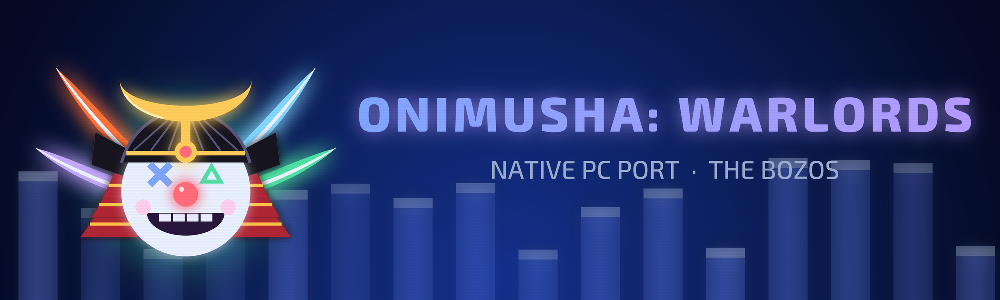

<div align="center">

# Onimusha_Recomp

**A native PC port of *Onimusha: Warlords* (NTSC-U, `SLUS-20018`), made by statically recompiling the game's PlayStation 2 code to C++. Windows now; Linux later.**<br>
Built on [BozoEngine](https://github.com/TheBozos/BozoEngine), The Bozos' own toolchain: the game's EE code recompiled to C++, every library and kernel call it makes answered by native code. No PS2 hardware model at any level: no GS, VU, VIF/GIF, DMA, IOP or SPU2.

-1b8cff)


</div>

> [!IMPORTANT]
> No game files are included: no ELF, overlays, IRX modules, data, or code generated from them.
> You need **your own copy** of the North American release, PS2 ID **`SLUS-20018`** (disc version 1.00). The port is
> built against that disc's executable:
>
> | File | SHA-1 |
> |---|---|
> | `SLUS_200.18` | `21166f0c7ec1ee2e6dfb87e81af242efaf521dc7` |

## Status

**Bring-up, headless.** The executable and its 98 code overlays are recompiled, Capcom's sound driver runs as
statically compiled native code, and the game's main loop runs its first 16 frames. The run stops at the first
background: Onimusha's pre-rendered rooms are IPU streams, the next thing to answer natively. Nothing is drawn yet.

| Milestone on BozoEngine | |
|---|:---:|
| Map the main ELF and every overlay from the game's own symbol table (CodeWarrior, symbols and DWARF kept) | ✅ |
| Recompile with `bozo-recomp`: the resident program and 98 `MWo3` modules (two enemy slots, rooms), each selected by its resident header | ✅ |
| Capcom's SNDDRVCD and Sony's modular synthesizer (LIBSD, SDRDRV, MODHSYN, MODMIDI, MODMSIN) statically compiled from the disc; the driver's RPC handshake, both ways | ✅ |
| Native frame boundary: main's vsync and CSR polling answered, `sceGsSwapDBuffDc` ends the frame | ✅ |
| Backgrounds: the IPU streams (`ETC/*.IPU`) and animated backgrounds (`BGS/*.IPU`) decoded natively | 🔧 |
| Movies (`MOVIE/*.PSS`) through BozoEngine's native libmpeg | ⏳ |
| Native rendering: characters, enemies, effects, sprites and the HUD from the game's own data | ⏳ |
| VU0 programs translated to C++ | ⏳ |
| Pads, memory cards, sound output | ⏳ |
| Window, title screen, the game playable | ⏳ |
| PC options: widescreen, render scale, anti-aliasing, frame interpolation, save states, cheats | ⏳ |

✅ works · 🔧 in progress · ⏳ not reached yet

[docs/RECOMP_NOTES.md](docs/RECOMP_NOTES.md) records how the port is brought up, every fix and how it was found, and
what remains open.

## Screenshots

None yet: nothing is drawn natively before the backgrounds.

## Goal

A fully playable *Onimusha: Warlords* as a native PC program, from the opening to the ending, drawing and playing
sound directly from the game's data. Accuracy and complete gameplay coverage come first; Linux, widescreen and
additional presentation options follow.

## How it works

```
disc files (game/) ──► tools/oni_prepare.py ──► resident ELF + 98 overlay ELFs (enemy slots 0/1, rooms, em090)
                                           │
                        BozoEngine's bozo-recomp ──► native C++ in build/bozo/oni_gen/
   six sound IRX ──► tools/oni_bozo_audio.py: relocation + strict native translation ──► build/bozo/oni_audio_gen/
                                           │
                 CMakeLists.txt ──► BozoEngine + generated code + Onimusha's own adapters
                                           │
   oni_port.cpp: frame boundary, CSR and display sites, IPU ──► native host services ──┐
   oni_audio.cpp: compiled drivers, the EE service 0x77777779 ──► native mixer         ├─► onimusha.exe
   generated module registration: overlays by resident identity ──► native dispatch ──┘
```

- `SLUS_200.18` keeps its CodeWarrior symbols and DWARF: 6,354 named functions, no symbol-map phase.
- Enemy and room code are `MWo3` modules inside the disc's `LMR` and `RDT` files, already linked at their slot
  (`0x4ba780`, `0x4c9500`, `0x4d8280`). Each module is its own generated image with its own function table; native
  dispatch checks the 64-byte header resident at the slot before selecting it.
- `SNDDRVCD.IRX` and Sony's synthesizer modules are relocated and compiled offline (BozoEngine's `tools/native_irx`);
  the game binds the driver over SIF RPC as on the console, and the driver's own calls back to the EE are served
  natively. Pad and card modules are answered at their SDK interfaces.
- The build generates everything automatically and links `onimusha` (window) and `oni-headless`. Game-derived output
  stays in the ignored build directory.

[BozoEngine](https://github.com/TheBozos/BozoEngine) is the sole engine submodule. Game-specific addresses, formats,
hook choices and module layouts stay in Onimusha_Recomp; engine changes must be generic and reusable by other ports.

## Requirements

- Windows 10/11 with [MSYS2](https://www.msys2.org/) (UCRT64, see below); Linux is not qualified yet
- CMake 3.21+, Ninja, GCC with C++20 support
- `bsdtar` (libarchive) to extract the disc, Python 3
- OpenGL 3.3 for the window; SDL3 and ImGui are fetched at pinned revisions by BozoEngine
- Your own copy of `SLUS-20018` (check the hash above)

## Build and run

```bash
git clone --recursive https://github.com/TheBozos/Onimusha_Recomp.git
cd Onimusha_Recomp
scripts/extract_iso.sh "Onimusha - Warlords (USA).iso"   # into game/
scripts/build_runtime.sh                                  # build/bozo/onimusha.exe and oni-headless.exe
scripts/run.sh --frames 600 --profile-io                  # the headless runner
```

The headless runner prints the end reason, the device accesses left by site (`--profile-io`) and the native library
calls by name (`ONI_CALL_STATS=1`): each stop is the next thing to answer. `--frames 0` runs until shutdown,
`--pad-script <file>` drives the pad, `--wav <file>` records sound, `--dump-ram <file>` writes EE memory at the end.
`ONI_WINDOW_RUN=1 scripts/run.sh` runs the window build instead; `-DONI_WINDOW=OFF` builds the headless runner only.

`tools/oni_disasm.py <SLUS_200.18> <function | 0xADDR>` disassembles the resident code with the game's symbols
(needs `capstone`).

### Windows

Run the scripts in an MSYS2 **UCRT64** shell; MSVC is not supported for this port.

```bash
pacman -S --needed mingw-w64-ucrt-x86_64-{gcc,cmake,ninja,pkgconf,libarchive,python} git
```

## Disc facts

| | |
|---|---|
| Boot ELF | `SLUS_200.18`, entry `0x100008`, one segment at `0x100000` (code and data, BSS up to `0x4ba780`), symbols and DWARF kept |
| Code | `0x100000-0x1e9e00` (EE code), `0x1e9e00-0x1eeb40` (VU1 and VU0 microcode) |
| Overlays | `MWo3` modules: enemies in `IMAGE/LMR/*.LMR` at `0x4ba780` / `0x4c9500`, rooms in `IMAGE/RDT/*.RDT` at `0x4d8280`, `em090` at `0x2bf200` |
| Video mode | NTSC |
| IOP modules | `IMAGE/MODULES/*.IRX`: SIO2MAN, PADMAN, MCMAN, MCSERV, LIBSD, MODHSYN, MODMIDI, MODMSIN, SDRDRV, SNDDRVCD (Capcom's driver, ver 1.75); unused: the HD/HL/CL driver variants and the network stack (INET, ILINK, ILSOCK, AN986, USBD) |
| IOP image | `IMAGE/MODULES/IOPRP202.IMG` |
| Data | `IMAGE/`: backgrounds (`ETC`, `BGS`: IPU), movies (`MOVIE`: PSS), models and textures (`PLD`, `LMR`, `RDT`), music (`BGM`), effects (`SE`), voices (`VOICE`, English and Japanese) |

## Sharing the machine with other ports

The Bozos' ports share a two-slot bench lock (BozoEngine's `tools/bench_lock.sh`): a game run takes one slot, a build
or a timed run both, in arrival order.

```bash
scripts/bench_run.sh 5 "headless boot" scripts/run.sh --frames 600
scripts/bench_run.sh --alone 30 "full rebuild" scripts/build_runtime.sh
```

## Repository layout

| Path | Contents |
|---|---|
| `BozoEngine/` | Sole engine submodule: native recompiler and runtime |
| `runtime/` | Onimusha's adapters: the frame boundary, native sites, sound modules, the window's icon (`app/`) |
| `scripts/` | Extraction, builds, runs and the bench lock |
| `tools/` | Offline preparation (resident and overlay images, module registration, sound modules) and analysis helpers |
| `docs/` | Recompilation notes and branding (`make_logo.py oni` makes the banner and icons) |

Game-derived code, disc files, generated assets and saves stay local and ignored. No game executable, disc files or
generated game code are distributed.

## Credits

- **The Bozos**: boubou666 and Arzaroth, who make this port and BozoEngine
  ([RecompWatcher](https://thebozos.github.io/RecompWatcher/) shows our projects).
- [BozoEngine](https://github.com/TheBozos/BozoEngine), The Bozos' MIT recompiler and native runtime.
- The team's other recompilations, *Dark Cloud* first (the same toolchain, overlays and sound modules), then
  *Twisted Metal: Black*, *The Lord of the Rings: The Third Age*, *Valkyrie Profile 2: Silmeria* and *Jade Cocoon 2*,
  which share native development work.
- *Onimusha: Warlords* © Capcom. This is an unofficial fan project, not affiliated with or endorsed by Capcom.

## Licence

MIT, see [LICENSE](LICENSE). Game data is never part of this repository: every port builds from the player's own disc.
